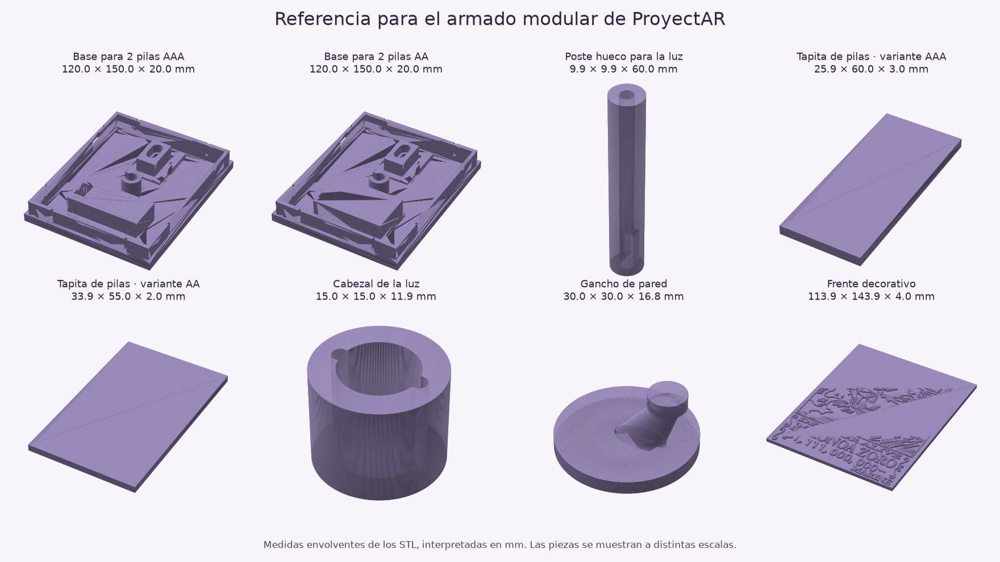

# Referencia de lámpara de sombra modular

Este documento conserva la inspección del modelo de referencia y decisiones históricas. Las menciones a 2 AAA, columnas de esquina o tapas interiores no describen el montaje vigente. Para el generador actual de 1 W con 3 AAA o USB, base inicial de 20 mm, guías exteriores y acceso posterior a pilas, ver [fabricación](../../components/shadow-fabrication.md).

Inspección del 28 de octubre de 2026. Preferencia del usuario: **2 pilas AAA** como variante principal, tomando como inspiración el armado de estos STL. La variante para 2 AA puede ser una alternativa del selector. No se identificó una variante independiente para una batería recargable.

Origen local: `C:\Users\jpmor\Downloads\索隆投影灯（电池盒版）墙面拆分版++_stls`.

**Terminaciones posteriores:** a partir de las nuevas capturas del usuario se suavizaron las esquinas exteriores de la base, caja electrónica, alojamiento de pilas y tapita. El anclaje tiene entrada circular y cuello de extremo redondeado; el refuerzo incorpora esquinas inferiores curvas. La boca del collar del tubo tiene un chaflán de 0,3 mm. Son terminaciones propias, compartidas por vista y STL, que conservan las cotas rectas y los asientos interiores del prototipo.

## Qué contienen los archivos

Medidas envolventes obtenidas de los vértices, interpretadas en milímetros. STL no almacena una unidad física. Las posiciones originales de las piezas están distribuidas en una bandeja; no representan posiciones de ensamblaje.

| Archivo | Interpretación | Envolvente X × Y × Z |
| --- | --- | --- |
| `obj_1_组合体.stl` | Frente decorativo con relieve | 113,90 × 143,90 × 4,00 |
| `obj_2_3.stl` | Panel de proyección 3 | 65,40 × 147,00 × 9,56 |
| `obj_3_2.stl` | Panel de proyección 2 | 65,40 × 147,00 × 9,70 |
| `obj_4_4.stl` | Panel de proyección 4 | 61,91 × 120,00 × 4,20 |
| `obj_5_1.stl` | Panel de proyección 1 | 61,94 × 120,99 × 4,20 |
| `obj_6_灯帽.stl` | Cabezal / capuchón de la luz | 15,00 × 15,00 × 11,92 |
| `obj_7_墙上挂钩.stl` | Gancho de pared | 30,00 × 30,00 × 16,83 |
| `obj_8_电池盖.stl` | Tapita de pilas, asociada por tamaño a AAA | 25,90 × 60,00 × 3,00 |
| `obj_9_2AA电池盖子.stl` | Tapita para variante AA | 33,95 × 55,00 × 2,00 |
| `obj_10_灯柱9.9.stl` | Poste hueco con entrada lateral para cable | 9,90 × 9,90 × 60,00 |
| `obj_11_2AAA.stl` | Base con alojamiento para 2 AAA | 120,00 × 150,00 × 20,01 |
| `obj_12_2AA.stl` | Base con alojamiento para 2 AA | 120,00 × 150,00 × 20,01 |

Se inspeccionaron vistas de las mallas y cortes horizontales de ambas bases a 1, 5, 10 y 17 mm. Las bases tienen un alojamiento central para el poste, un sector rectangular para alimentación y un alojamiento superior con forma de ojo de cerradura compatible visualmente con el gancho. Los detalles de retención y el ajuste entre piezas requieren comprobar el ensamblaje; las envolventes no son cotas de encastre.

El compartimento no demuestra que las pilas se instalen directamente contra contactos impresos: no hay información sobre contactos metálicos, portapilas comprado ni interruptor. La foto de componentes aportada posteriormente identifica el conjunto luminoso original como un LED de 1 W sobre placa de aluminio con resistencia limitadora, pero no proporciona sus cotas ni el valor de esa resistencia.

## Hardware aportado por el usuario

- LED seleccionado: blanco frío, 1 W, vendido por Candy-Ho. [Publicación proporcionada](https://www.mercadolibre.com.ar/10x-led-1w-colores-smd-alto-brillo-luz-luminosidad-alta-luz-blanco-frio/p/MLA69810586). No se pudo acceder al contenido de ese enlace mediante la herramienta web; no se verificaron las dimensiones ni los parámetros eléctricos del artículo exacto.
- Placa estrella candidata: publicación de Nubbeo, pack de 10, anunciada para LEDs SMD de dos pines de 1/3/5 W. El texto y la captura facilitados por el usuario especifican **20 mm de diámetro y 1,2 mm de espesor**. Son medidas nominales declaradas por el vendedor, no medidas físicas verificadas. La foto muestra placas sin LED montado.
- Foto de MakerWorld: el texto `1W铝基板LED 灯珠带限流电阻` se interpreta como «LED de 1 W sobre placa de aluminio, con resistencia limitadora de corriente». No se puede deducir de la foto el diámetro de su estrella, el valor de la resistencia o la tensión de alimentación requerida.

Para el futuro cabezal se puede usar una envolvente nominal de placa de 20 × 1,2 mm y una holgura de fabricación independiente y ajustable. **1,2 mm no es la altura total del conjunto LED + placa.** El asiento, la fijación y la longitud del poste deben considerar por separado el relieve del LED, la conexión térmica, el cableado y cualquier disipador adicional. El cabezal de referencia mide aproximadamente 15 mm de diámetro exterior; una estrella de 20 mm requiere adaptar su geometría y no puede suponerse que entre dentro de él.

La estrella es, por su aspecto, una placa de circuito de base metálica para montar el LED y distribuir su calor. No se ha confirmado que su huella coincida con el encapsulado seleccionado ni que pueda disipar por sí sola la potencia prevista dentro de la lámpara. La [guía térmica de Cree LED](https://downloads.cree-led.com/files/da/x/XLamp-Thermal-Management.pdf) distingue la placa del disipador y explica la dependencia del montaje y del ambiente; no valida este producto concreto.

Con dos AAA, la alimentación debe definirse junto con la corriente real del LED. Para mantener brillo regulado durante la descarga puede emplearse un controlador elevador de corriente constante compatible con dos celdas, como principio de funcionamiento explicado por [Analog Devices](https://www.analog.com/en/resources/design-notes/highpower-whiteled-driver-operates-on-1-or-2-alkaline-cells.html). No se seleccionó un módulo ni una corriente objetivo. No asumir conexión directa, copiar una resistencia de valor desconocido ni interpretar «DC-DC» como garantía de regulación de corriente.

## Aplicación al generador

El generador actual en `src/features/shadowbox/` produce cuatro paredes y una tapa frontal, con soportes integrados para LEDs individuales o rebajes COB. Los cambios locales existentes en esos archivos se conservaron durante esta inspección.

La referencia sugiere esta evolución:

- Base estructural con compartimento de alimentación y acceso desmontable a las pilas.
- Selector de alimentación: 2 AAA como opción principal y 2 AA como alternativa, con sus propias medidas de alojamiento y tapita.
- Poste hueco desmontable, con longitud calculada desde la posición óptica configurada y la altura real del conjunto LED/disipador.
- Cabezal intercambiable adaptado al LED de 1 W y su disipador.
- Cuatro paneles de proyección generados a partir de la imagen del usuario, conservando una geometría común para la simulación, la vista 3D y los STL.
- Frente decorativo y gancho separados si se adopta el conjunto completo del ejemplo.

No basta con cambiar el texto de un selector: `fabricationParts`, las transformaciones de armado, la guía y la exportación deben admitir un número variable de piezas. Actualmente varias etiquetas y el nombre del STL combinado asumen cinco piezas. El modelo de referencia tiene variantes alternativas; sus doce archivos no deben ensamblarse todos simultáneamente.

El tamaño de las pilas o del portapilas y del LED/disipador debe mantenerse en milímetros al cambiar el tamaño del cuadro. No escalar esos alojamientos con el dibujo. El poste también debe respetar la posición de luz usada para calcular los recortes.

## Información pendiente para definir el montaje

- Ficha o medidas verificadas del encapsulado del LED; el enlace ya fue proporcionado.
- Confirmar la huella de montaje de la estrella candidata y la altura total del conjunto; el diámetro nominal de 20 mm y el espesor nominal de placa de 1,2 mm ya fueron proporcionados.
- Definir la alimentación del LED con 2 AAA y verificar la disipación en el montaje previsto antes de cerrar los alojamientos de electrónica.
- Si se utiliza un portapilas comercial de 2 AAA, sus dimensiones exteriores y salida de cables.
- Enlace del modelo de MakerWorld, si está disponible, para consultar instrucciones de armado y componentes originales.

Actualización posterior: el usuario eligió pasar a **3 AAA alcalinas**, con **USB regulado de 5 V** como alternativa, y autorizó implementar el prototipo. El generador incorpora ahora el modo **LED de 1 W · armado modular**; ver [fabricación](../../components/shadow-fabrication.md). Conserva la inspiración del poste, cabezal y compartimento, con geometrías propias paramétricas. No replica el frente decorativo de Zoro ni el gancho del archivo original. La altura real del emisor y la envolvente del portapilas siguen pendientes de medir; sus controles indican valores provisionales. El montaje físico, óptico y térmico sigue pendiente de prueba.

Actualización de orientación: el usuario confirmó **tapa frontal hacia la persona y sombra en la pared detrás**, como en la foto. Se separaron físicamente la placa portaluces, la caja electrónica del lado de la persona y la tapa exterior. El LED de 1 W ahora usa nueve piezas (AAA o USB), COB siete. El selector visible sólo ofrece esas dos luces. El resto de las mediciones de los STL originales conserva su carácter de referencia, sin copiar el frente decorativo ni sus unidades implícitas.

**Aclaración del usuario, 28/10/2026:** la base con ojo de cerradura debe ir contra la pared y contener el portapilas; después se montan tapita de pilas, tapa electrónica con paso central, tubo, paredes y embellecedor. Se reemplazó la disposición anterior del software que había puesto la electrónica delante.

**Corrección posterior:** el frente debe quedar abierto; el embellecedor es un marco, sin placa central. El cierre liso o con el arte de la sombra pertenece a la tapa electrónica trasera, junto a la pared, con agujero central para tubo/cables. COB se aloja sobre el perímetro del marco. El colgado y la calibración física del prototipo nuevo están pendientes; el generador no certifica reproducir el funcionamiento del STL original.

**Arranque de paneles:** otra captura del usuario aclaró que las paredes se colocan en el borde bajo de la base, no encima de toda la caja electrónica. En el generador se separó un reborde a 4 mm de la pared de la caja de 24 mm, retirada 6 mm del borde. Los paneles se alargan hacia atrás conservando LED y frente. En el STL original AAA se midieron superficies de fondo alrededor de Z=3,01 mm y un borde exterior hasta aproximadamente Z=7,46 mm, junto con otras superficies interiores hasta 20 mm; esos cortes no determinan por sí solos la posición exacta del encastre. Las cotas nuevas son paramétricas propias. La simulación no verifica la sombra física de la base opaca.

**Recorte delantero y zona bloqueada:** el usuario aclaró después que quiere acortar las paredes hasta el LED teniendo en cuenta la parte tapada por la tapa inferior. El modelo de 1 W ahora termina detrás del cabezal con holgura; el marco se acerca, manteniendo la altura del emisor. La simulación incorpora las sombras de base, tapas y soportes impresos, y calcula el porcentaje estimado del área de recortes bloqueada. Se omiten los completamente ocultos en la malla y en la exportación. No se traslada el dibujo, porque alteraría la proyección. COB conserva su extremo delantero al llevar la tira sobre el marco y sigue aproximado con una fuente puntual.

**Corrección de la franja vertical del cabezal:** reproducida con 8 × 13 cm y luz al 70% (emisor a Z=66 mm). Las dos patas de la horquilla cruzaban el plano emisor y proyectaban una franja hacia arriba y abajo; el filtro de oclusión la trasladaba también a las máscaras. Se sustituyó por un puente detrás del LED, con dos tetones encastrados en rebajes posteriores del marco, entre las uniones de pared. Todo el cabezal impreso queda del lado de la habitación respecto al emisor. El tubo central pasa a guiar cables; no sostiene el cabezal. La regresión comprueba sombra nula del cabezal, continuidad de los recortes centrales, mallas cerradas y encastres presentes. El ajuste de los encastres y el tendido real de cables requieren prototipo.

**Alojamiento circular del tubo:** el usuario señaló que el tubo Ø10 tenía alojamiento y paso cuadrados. Se redondearon el collar y alojamiento ciego de la base y la abertura pasante de la tapa, conservando la holgura diametral y el paso lateral de cables. La tapa lisa y la tapa con relieve comparten el cambio; el paso COB también es circular. Las demás uniones conservan sus formas funcionales.

**Arranque por encima de la tapa y carga inicial:** ante una nueva captura el usuario aclaró explícitamente que quiere subir el comienzo de las paredes, no el LED. Los paneles ahora arrancan a la altura de la tapa y de su relieve, sobre cuatro columnas de esquina unidas a la base. Se elimina el tramo trasero escondido conservando LED y marco. Se regeneran los recortes desde ese plano. Además, al abrir/importar un proyecto o entrar en 3D se ajusta una posición LED incompatible al valor válido más cercano; el 85% anterior pasa a 83% con los valores iniciales e informa el ajuste. Los proyectos válidos se conservan y guardar sigue siendo explícito.
